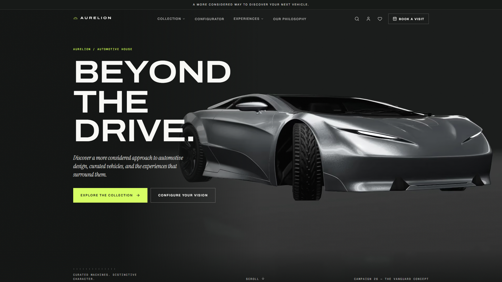
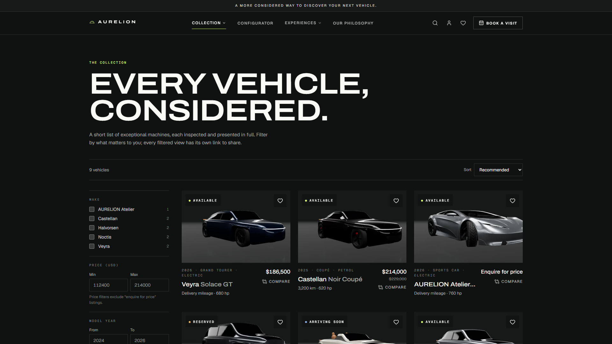
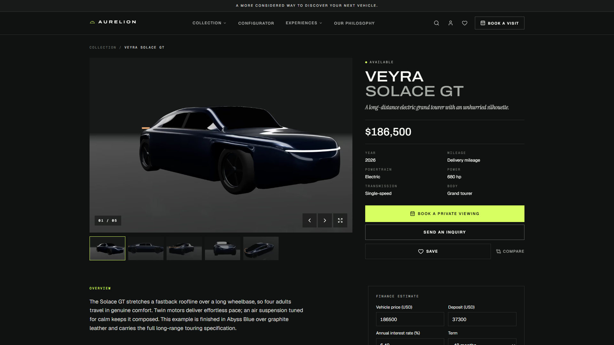
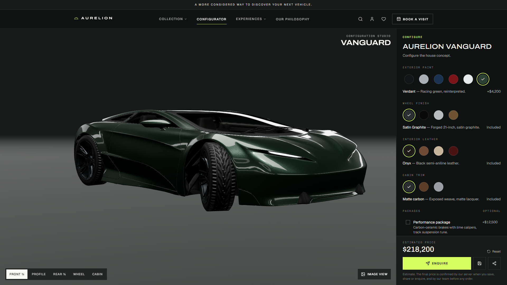
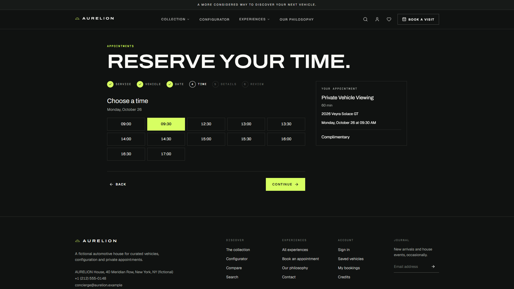
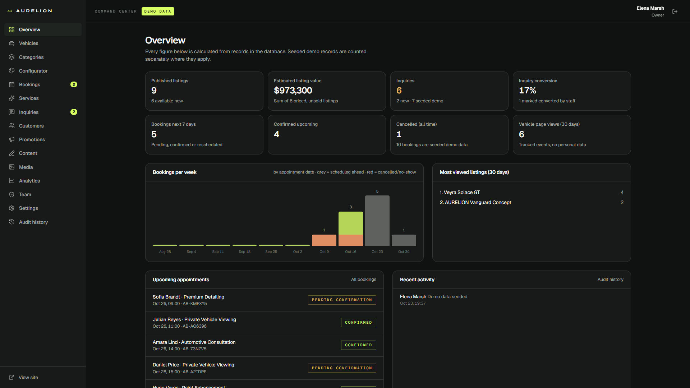
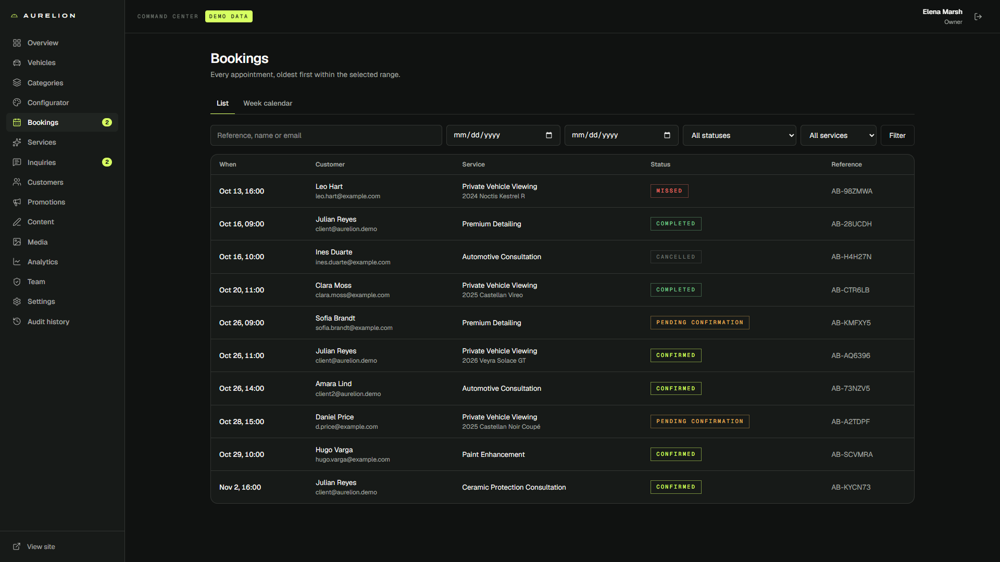
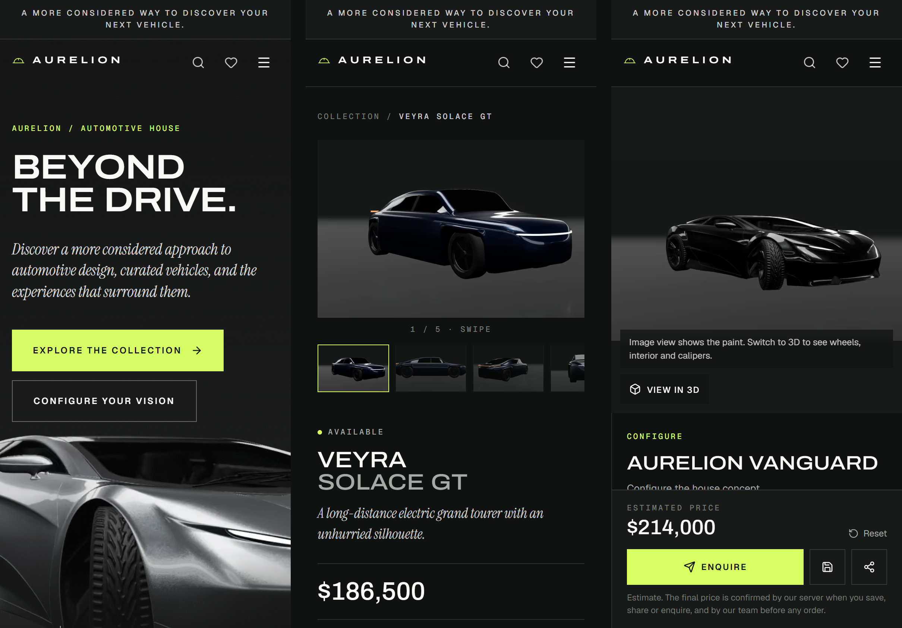

# AURELION — Luxury Automotive Platform

A full-stack platform for a car dealership: a vehicle marketplace, a 3D configurator with server-side pricing, appointment booking that blocks double bookings, customer accounts and an admin command center. AURELION ("BEYOND THE DRIVE.") is a fictional brand, and all vehicles and records are demo data.

**Live demo:** https://aurelion-muad1.vercel.app
**Hire me to build yours:** https://www.fiverr.com/mouadseehli/build-your-car-dealership-website-with-a-3d-configurator-and-booking
**Launch film (33 s):** https://x.com/MuadDevvlxn/status/2113792435398611152

> This repository is a showcase: screenshots and a feature overview only. The source code is not public.

## What it does

- **Marketplace:** 9 listings with filters (make, body, powertrain, price, year), sort, search and shareable filter URLs. Each vehicle has a detail page with a gallery and lightbox, favourites, a side-by-side compare and a finance estimate. Any listing can be marked "Enquire for price".
- **3D configurator:** paint, wheels, interior, trim and packages on a real-time WebGL car.
  - Incompatible options are disabled.
  - The browser shows the price live, but the server re-prices every saved, shared or enquired configuration from the database, so a price edited in the browser is ignored.
  - Configurations can be saved to an account or shared by link.
  - Phones and devices without GPU acceleration get pre-rendered images instead of a blank canvas.
- **Booking:** private viewings, test drives and detailing.
  - Slots come from business hours, closed dates, lead time, buffers and how far ahead bookings open, all in the store's own time zone.
  - Each confirmation locks the resource and re-checks the slot in the database. Three people booking the same slot at the same moment: exactly one succeeds (covered by an integration test).
  - Guests get a private link to manage or cancel their booking.
- **Customer accounts:** saved vehicles, configurations, bookings and inquiries, plus password reset.
- **Admin command center:**
  - vehicles: draft, publish, archive
  - categories and configurator options with prices
  - bookings: list and week calendar, status changes, rescheduling with conflict checks
  - services and opening hours
  - inquiries with notes, customers, promotions
  - editable site content, media library
  - analytics, staff roles (Sales, Service manager, Admin, Owner) and an audit history

## Screens

| | |
|---|---|
|  |  |
|  |  |
|  |  |

## Stack

Next.js 16 (App Router), React 19, TypeScript, Tailwind CSS 4, PostgreSQL with Prisma 7, Three.js with React Three Fiber, Motion, Zod, signed-cookie sessions with bcrypt, Vitest and Playwright. Hosted on Vercel with a Neon database.

## Quality

- **Tests:** 38 unit and 15 integration tests (real database), plus 6 end-to-end browser journeys covering discovery, configurator, booking, admin, security and mobile.
- **Route check:** every page checked for errors and horizontal overflow at 360–1440 px.
- **Security:** server-side role checks on every admin page and action; customers only ever see their own data; validation and rate limits on all forms; security headers and a Content Security Policy.

## Not included

- Online payments: services are settled at the appointment.
- Transactional email needs your own email-provider account (Resend); without one, messages are logged instead of sent.
- The configurator uses one licensed 3D car model (CC BY 4.0, credited on the site). Other models need their own 3D files.
